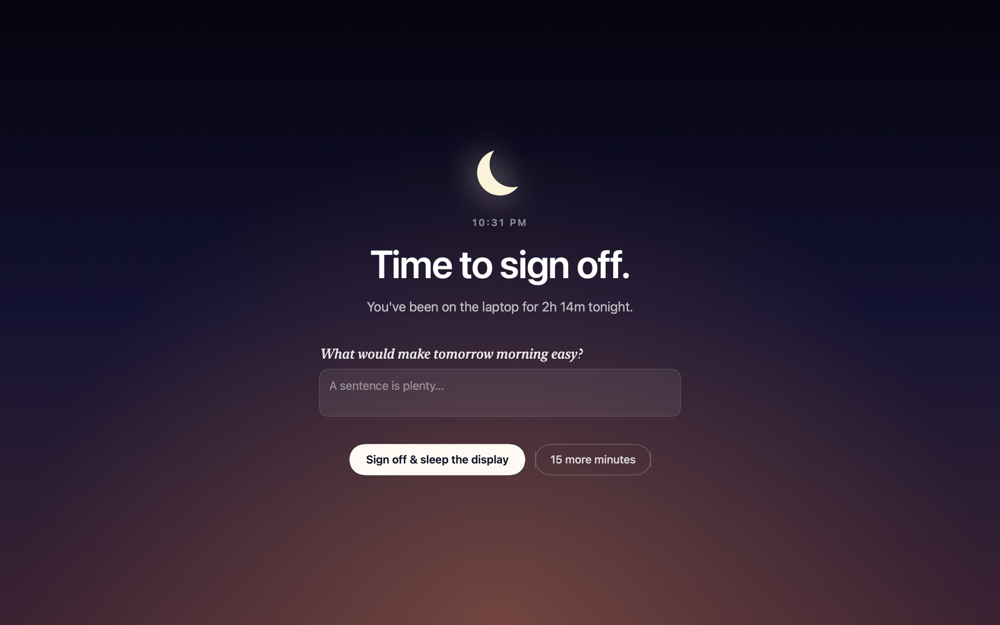

# Suspenders

Gentle support for the habits you're building.

- **A calm new tab.** The clock, a greeting and one thing to read: a quote that matches your values, or a passage from your own Obsidian notes. A small daily nudge towards the person you want to be.
- **Interrupts the autopilot on YouTube, any time of day.**
  - Shorts and recommendations are dimmed and grey. They come partway back only if you hover over them on purpose.
  - On every 3rd video in a row (Shorts count), a reflection card asks something like *"What are you learning?"* or *"Who are you becoming with this?"*. Write a few words to continue, or save the video for later. Answers collect under **Settings → Reflections**.
- **Evening friction on YouTube (8:30 PM by default).**
  - A 10-second pause before each visit.
  - Recommendations, Shorts and autoplay are hidden.
  - The page slowly turns grey the longer you watch.
- **YouTube rests at night (10 PM by default).** You can still unlock it if you really need it:
  1. Write a reason of at least 20 words.
  2. Wait 5 minutes.
  3. YouTube unlocks for 15 minutes.

  Every reason is logged so you can look for patterns later.
- **A soft push to sign off (Mac helper).**
  - Gentle notifications.
  - A warm amber tint that slowly deepens.
  - A menu-bar counter of time past bedtime.
  - A wind-down card at 10:30 PM with one reflection question.



It has two parts:

| Part | What it does | Required? |
|------|--------------|-----------|
| `extension/`: Chrome extension (MV3, no build step) | New tab, YouTube friction and blocking, unlock flow, settings | Yes |
| `helper/`: macOS menu-bar app (Swift) | Reads your Obsidian vault, tracks laptop time, sign-off nudges, writes the late-night log | Optional |

The extension works on its own with built-in quotes. The helper adds your notes and the nudges that cover the whole laptop, not just Chrome.

## Install

### Chrome extension

1. Open `chrome://extensions` and turn on **Developer mode**.
2. Click **Load unpacked** and choose the `extension/` folder.
3. Open a new tab. The settings page opens on first install. You can set:
   - your name
   - the evening and night times
   - the unlock rules
   - your own quotes

### Mac helper (optional, macOS 13+)

```bash
./helper/build-app.sh --install
```

This builds `Suspenders Helper.app`, copies it to `/Applications` and launches it. A moon appears in the menu bar. From there:

1. Choose **Choose Vault Folder…** and pick your Obsidian vault.
2. Turn on **Open at Login**.
3. Allow notifications when macOS asks.

## Choosing which notes appear

The helper only reads notes carrying one of the configured tags, in frontmatter or inline:

```markdown
---
tags: [nudge]
---
```

| Tag (default) | How it's shown |
|---------------|----------------|
| `#nudge`, `#anki` | Split into passages by heading and paragraph, then one passage is shown at a time |
| `#quote` | Each blockquote or list item is a separate quote. `— Author` is picked up, either at the end of the line or on the next line |

Nested tags count too, so `#anki/books` matches `anki`. Each card has an **Open in Obsidian** link.

## Settings

- **Extension:** the ⚙︎ on the new tab, or right-click the extension → Options.
- **Helper:** menu bar → **Edit Settings (config.json)…**, then **Reload Settings**. The file lives at `~/Library/Application Support/Suspenders/config.json`:

```jsonc
{
  "vaultPath": "/path/to/your/vault",
  "tags": ["nudge", "anki", "quote"],
  "quoteTags": ["quote", "quotes"],
  "signOffTime": "22:00",       // notifications + tint start
  "windDownTime": "22:30",      // full-screen wind-down card
  "morningTime": "05:00",       // everything resets
  "eveningCountFrom": "18:00",  // "time on the laptop tonight" starts counting
  "nudgeIntervalMinutes": 15,
  "tintEnabled": true,
  "maxTintOpacity": 0.35,
  "reasonsLogInVault": null,    // e.g. "Suspenders/Late night log.md" to keep the log in your vault
  "port": 47615
}
```

The extension and the helper each keep their own sign-off time. If you change it, change it in both places.

## The late-night log

- **In the extension:** unlock reasons and video reflections are kept under **Settings → Late-night reasons** and **Settings → Reflections**. You can copy both as Markdown.
- **With the helper running:** reasons, video reflections, wind-down reflections and every "15 more minutes" are also appended to a Markdown file. It goes in Application Support by default, or in your vault if you set `reasonsLogInVault`.

## Privacy

- Nothing leaves your machine. There are no analytics and no accounts.
- The helper listens on `127.0.0.1` only and refuses requests from web pages. Only the extension, or local tools like `curl`, can talk to it.
- Your vault path, tags and log live in your local config. Nothing personal is stored in this repo.

## Development

```bash
npm test                          # extension logic (node:test)
cd helper && swift test           # markdown parsing + schedule
cd helper && swift run            # run the helper without bundling (notifications fall back to logs)
swift scripts/make-icons.swift    # regenerate icons
```

### Ideas for later

- Email-to-self as an unlock requirement.
- A hard block with no override.
- A "wrap up" cap on watch sessions.
- Readwise and Notion as note sources.
- Background photos.
- Sharing one set of times between the extension and the helper.

## License

MIT
